West Visayas State University  
College of Information and Communications Technology  
La Paz, Iloilo City

# Synergy

**Complementary Matching and Milestone Tracking for Startup Collaboration**

**Final Project Document**  
**CIT 213 – Human-Computer Interaction 2**  
BSIT 3B


**Prepared by**  
Amaguin, Justin Jerrickho  
Dayao, Kurt David G.  
Hermosura, Moses John C.  
Japitana, Joseph Angelo  
Moje, Juan Carlos

**Submitted to**  
Ma’am Janine Defante

**November 2026**

---

# PROPOSED TITLE

**Synergy: Complementary Matching and Milestone Tracking for Startup Collaboration**

# PROBLEM

## 1. Introduction

An early-stage startup may need specialist guidance before it can decide what to test, build, or change. Making contact is only one part of the problem. A founder must identify a mentor with relevant expertise, communicate the issue clearly enough for the mentor to respond, and retain the advice or agreed next step. A mentor must judge whether the question fits their expertise, whether they have time to take it on, and what the founder expects to receive. A vague initial request can leave both parties uncertain about the scope of the work and how to proceed.

The project originated in Western Visayas. The Department of Science and Technology Regional Office VI (2025) reports that regional institutions, including university incubators, worked together on a startup development action plan that includes startup support and knowledge transfer. This establishes a local context for examining how startups obtain guidance. Synergy is designed for early-stage founders and domain experts beyond a single institution or region.

The September concept document illustrates the founder-side problem through Juan Mohi, a provisional persona seeking expertise and pilot partners for a scam-detection product (Amaguin et al., 2026). For a mentor, the corresponding design requirement is enough context to decide whether to accept an engagement without first reconstructing the founder’s situation through several messages. Both descriptions inform the prototype. [Evidence needed: anonymized founder and mentor accounts of recent outreach, request triage, and follow-through, with the recruitment context and dates.]

## 2. Current Solution

The concept document identifies personal referrals, professional networks, and chance encounters as routes to finding collaborators. A referral may provide credibility and a useful introduction. Its reach depends on who is in the founder’s network, and the founder and mentor still need a way to agree on the purpose of the engagement. Existing mentoring services provide another route. Micromentor, for example, documents entrepreneur profiles, mentor search, direct contact, and tools for sharing notes and setting action plans (Micromentor, n.d.-a, n.d.-b).

When a founder uses separate tools for discovery, messaging, and follow-up, the question, the mentor’s answer, and the agreed actions can end up in different places. For the mentor, an unstructured inquiry may omit prior attempts, the desired outcome, or the expected commitment. These are limitations of the workflow Synergy addresses as a design proposition. Their frequency and severity in the intended population remain open questions. [Evidence needed: anonymized examples or observation records showing how founders and mentors currently find one another, manage requests, and keep track of advice.]

## 3. Proposed Solution / Methodology in Solving the Problem

Synergy is a web application that connects discovery with the work that follows. A founder can inspect the basis of a match and send a mentorship request with a problem, prior attempts, and a specific question. A mentor can judge the request against their expertise and workload, then accept, decline, or suggest an alternative. Acceptance creates a shared Mentorship Room whose controls depend on the agreed format. The wider application also supports founder-to-founder exchanges through Deal Rooms with shared terms and milestones.

The midterm team considered Collab Board, a public listing of collaboration needs, and Embeddable Collab Cards, shareable descriptions of those needs. It selected Synergy to connect complementary matching with a workspace for the resulting engagement (Amaguin et al., 2026). The early prototypes represented that lifecycle through a general Deal Room. The implementation subsequently introduced role-specific navigation, structured request handling, and format-specific Mentorship Rooms. Internal reviews and automated regressions documented interface changes and checked functional behavior. The evaluation chapter records the checks repeated on the current build. [Evidence needed: dated research notes and design decisions showing how intended users, especially mentors, informed the requirements and prototype iterations.]

## 4. Conceptual Framework

**Figure 1. Conceptual framework for Synergy**

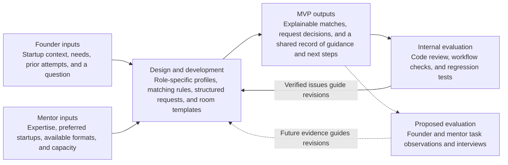

Figure 1 links each role’s information to the way Synergy presents and manages a mentorship opportunity. Founder and mentor signals contribute to discovery. A structured request carries the founder’s question to the mentor, and the mentor’s decision determines whether a shared room is opened. The room makes the next action and the outcome visible to the appropriate person. Solid arrows show the implemented workflow and documented technical review. Dashed arrows show the proposed feedback cycle with intended users.

## 5. Objectives

### General Objective

Develop a web MVP that helps early-stage startup founders and mentors identify a relevant opportunity, make an informed decision about working together, and maintain a shared record of the resulting engagement.

### Specific Objectives

1. Enable a founder with a completed profile to identify at least one eligible mentor, inspect a fit explanation, and submit one Quick Ask containing a problem, prior attempts, and a specific question.
2. Enable a mentor to locate that request, identify its proposed format and response deadline, and record a decision. Verify acceptance and the resulting room, and check referral and capacity-limited acceptance as separate paths.
3. Verify with two independent local accounts that acceptance creates the same room for both parties, the mentor can deliver a written answer, and the founder can retrieve the saved answer after reopening the room.
4. In a future formative study, record completion, time, assistance, errors, and correct interpretation of status for each founder and mentor task in Appendix A. The proposed criterion is at least 80% independent completion of the core task in each role, with raw counts reported alongside the percentage.

# SYSTEM / APP IMPLEMENTATION

## 1. System Overview

Synergy is a browser-based application for early-stage startup founders and mentors offering domain expertise. The founder workspace centers on **Matches**, **Introductions**, and **Deal Rooms**. The mentor workspace centers on **Requests**, **Mentees**, **Calendar**, and **Impact**. Both roles can use **Updates** for activity and return to a shared **Mentorship Room**. A moderator role supports approvals and oversight. The two-role workflow demonstrated here uses free mentoring and separate local accounts.

### Startup founder experience

A founder comes to Synergy with a specific gap, such as deciding which product experiment to run. The founder’s profile supplies signals including what the startup needs and offers, industry, stage, team size, and collaboration goals. **Matches** shows eligible people and the reasons for their fit. A mentor’s match detail shows what they can help with, what they need from founders, and any supported formats and prices. The score guides the founder’s review of the profile. The founder decides whom to approach.

In the demonstration, Maya Cruz is working on a budgeting tool for student teams. She finds Eli Reyes through **Matches** and chooses **Quick Ask**, a written exchange suitable for a focused question. She describes where new users abandon onboarding, explains the changes already tried, asks which of two experiments to run, and provides an optional desired outcome. The form’s **Request quality** checklist lets her review the context before sending it. After submission, **Introductions** shows the request as `pending`, with a response deadline and **Withdraw**. When Eli accepts, the record changes to `accepted` and offers **Open mentorship room**. After he delivers a response, Maya can read the recommendation under **Answer**, mark **Helpful** or **Not helpful**, or leave a private review. Her task outcome is a written recommendation she can consult again when planning the experiment. Running that experiment takes place in the founder’s own product work.

### Mentor experience

A mentor comes to Synergy to advise startups on topics they know and manage the amount of work they take on. The mentor profile describes expertise and preferred startups. **Settings** includes the **Mentoring** controls for offered formats, response window, capacity, conflicts, and **Pause Mode**. New mentors in the standard local-account configuration must submit a mentor application and obtain moderator approval before appearing in discovery. The mentor’s **Home** presents requests, sessions, attendance and follow-ups, and capacity so the mentor can prioritize work before accepting additional engagements.

Eli sees Maya’s request in **Requests**, including the format, expiry, fit information, and the problem, prior attempts, specific question, and desired outcome she submitted. He can decide whether the request is within his expertise and can be answered within the offered commitment. **Accept** opens the room, **Decline** allows a reason and a message, and **Refer** sends alternative mentor suggestions to the founder. A referral leaves the founder in control of sending another request. In this demonstration Eli accepts, sees **Accepted** and **Deliver your answer**, and submits his advice under **Answer**. The room moves to **Delivered**, displays the saved response, and offers **Write review**. **Mentees** groups active rooms by stage and gives access to **Room history**. For scheduled formats, **Calendar** supports session management. **Impact** summarizes recorded mentoring activity and eligible reviews when data are available.

## 2. Core Features

| Feature | User action and system response | Current status |
| --- | --- | --- |
| Role-specific profiles and mentor onboarding | Founders publish startup signals. Mentors provide expertise, preferred startups, and offered formats. The application saves separate role data and controls mentor discovery through the approval flow in the standard configuration. | Working locally. Approval is covered by a browser regression. |
| Matches and fit explanations | Founders compare **Suggested**, **Saved**, and **Browse all**, inspect fit and profile details, and save profiles for later. Ranking considers role-specific signals, including availability and format for mentor matching. | Working locally. The fit score is a rule-based estimate and its predictive validity remains unmeasured. |
| Structured mentorship requests | Founders submit the problem, what they tried, a question, a format, and optional supporting context. The mentor sees the request with its response window and actions. The founder sees the decision in **Introductions**. | Working across two local accounts. The demonstration and browser tests cover complementary paths. |
| Capacity and request triage | Mentors set concurrent mentee and asynchronous work limits, monthly hours, and response time. The service checks availability and capacity, and the inbox provides actions or alternatives when acceptance is blocked. | Working locally. The capacity error and settings recovery path passed a browser regression. |
| Mentorship formats and room work | **Quick Ask** and **Doc/Pitch Review** use written delivery. **Single Session**, **Office Hours**, and **Ongoing Advisory** have controls for the relevant goal, booking or check-ins, attendance, and follow-up. The room presents format-specific stages and next actions. | Working local workflows with code and test coverage. The two-account live walkthrough in this manuscript covers **Quick Ask**. |
| Reviews, history, and impact | After eligible work, private reviews can be submitted. The service withholds the partner’s review during the blind stage, subject to the review-window rules. **Room history** and **Impact** let mentors revisit activity and see eligible summaries. | Working locally. A browser regression checked review visibility after one-sided submission. |
| Founder-to-founder exchanges | Founders can agree on terms, use a **Task board**, attach evidence, and mutually confirm milestones in a Deal Room. Exchange templates cover **Beta Testing Exchange** and **Co-Marketing Swap**. | Working locally as a secondary pathway, with regression coverage. |
| Preview, email, and payments | **Prototype role** launches a fictional role preview. The explicit **Simulate acceptance** control can stand in for an eligible fictional counterpart. In-app **Updates** work locally. The default email outbox is a stub, and checkout uses simulated payment events. | Prototype simulation is available. External email operation requires a configured provider. Live payments are outside the verified build. |

## 3. User Flow

### How founders and mentors work together

Figure 2 traces the free **Quick Ask** from both sides. Read down each role’s path to follow their actions and across the arrows to see what Synergy makes visible to the other person. Maya initiates the request and sees `pending` until Eli makes a decision. Eli sees the question and its context in **Requests**, together with the deadline and available decisions. Accepting opens a single shared room and gives Eli a place to deliver his response. The founder’s accepted request links to the same room, where the next-action text initially identifies that the answer is outstanding. Eli’s submission moves the room to **Delivered** for both parties. In the review follow-on, each side submits independently. The second submission releases feedback to both.

**Figure 2. Two-role user flow for a free Quick Ask**

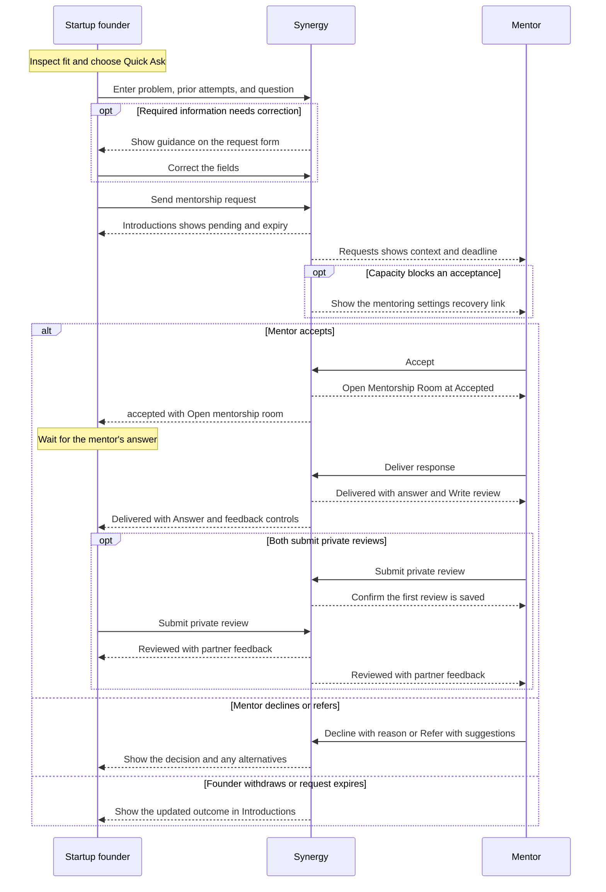

The photographed run followed the acceptance branch through delivery, then verified release after both accounts submitted a review. Browser tests separately covered referral and blocked acceptance. The `pending` and `accepted` labels are request-record states. **Requested**, **Accepted**, **Delivered**, and **Reviewed** are the stage labels in the Quick Ask room. Appendix C shows the review states. The next step, running the recommended experiment, belongs to the founder’s work outside the application.

## 4. Interface Screenshots

Figures 3–8 show the running local build at commit `b25350f`, captured on November 19, 2026 in Google Chrome. The viewport was 1280 × 1000 for the workflow captures. Figure 4 isolates the request panel at a 1280 × 2300 viewport using the same fictional example. All names and scenario content in the figures are test fixtures.

**Figure 3. Startup founder — Matches with a suggested mentor**

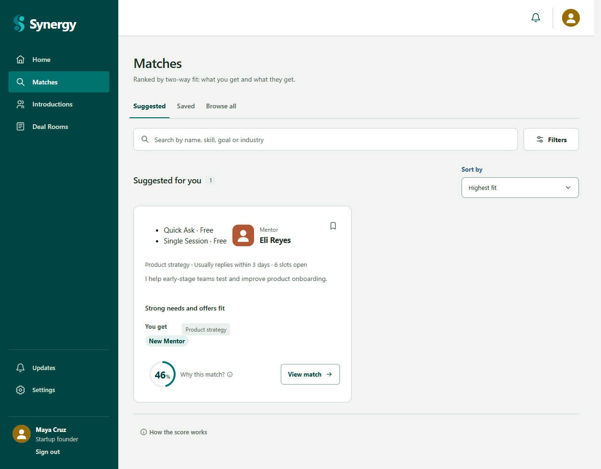

The card shows the mentor’s expertise, offered formats, a fit value, and a plain-language reason. **Saved** and **Browse all** support revisiting a profile and exploring beyond the suggested list.

**Figure 4. Startup founder — Completed Quick Ask before submission**

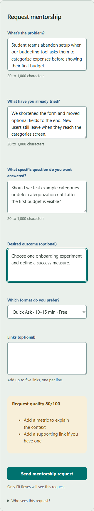

The form separates background, prior work, and the question. It identifies the selected format and price and states who will see the request, helping the founder assess scope and disclosure before submission.

**Figure 5. Startup founder — Introductions after sending the request**

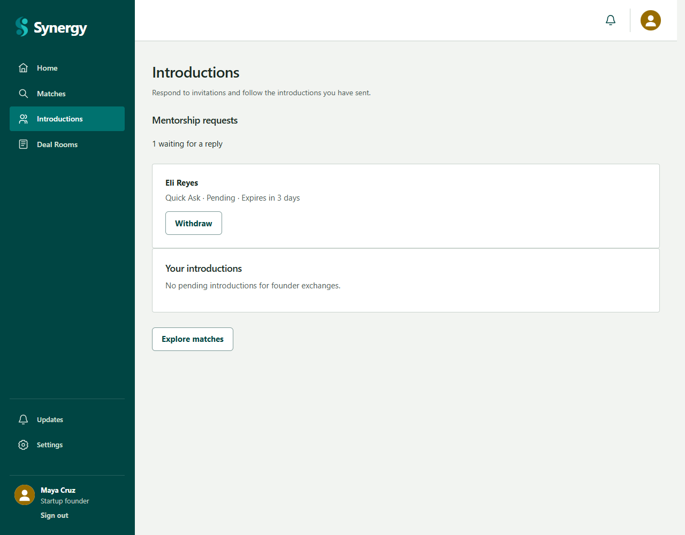

The request card shows `pending`, the remaining response time, and **Withdraw**. It gives the founder a durable way to verify receipt by the system after the transient submission feedback disappears.

**Figure 6. Mentor — Requests before a decision**

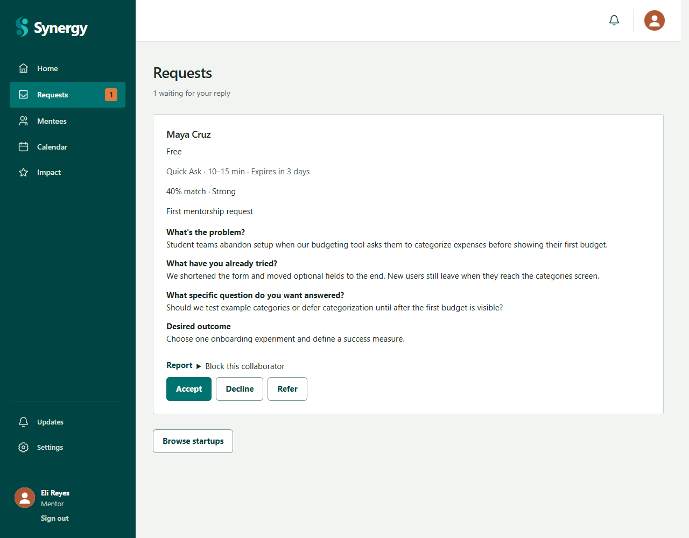

The mentor reviews the founder’s prompt and the request’s format and expiry in one place. The three decision controls remain visible beside that information.

**Figure 7. Mentor — Accepted Quick Ask with a response ready to submit**

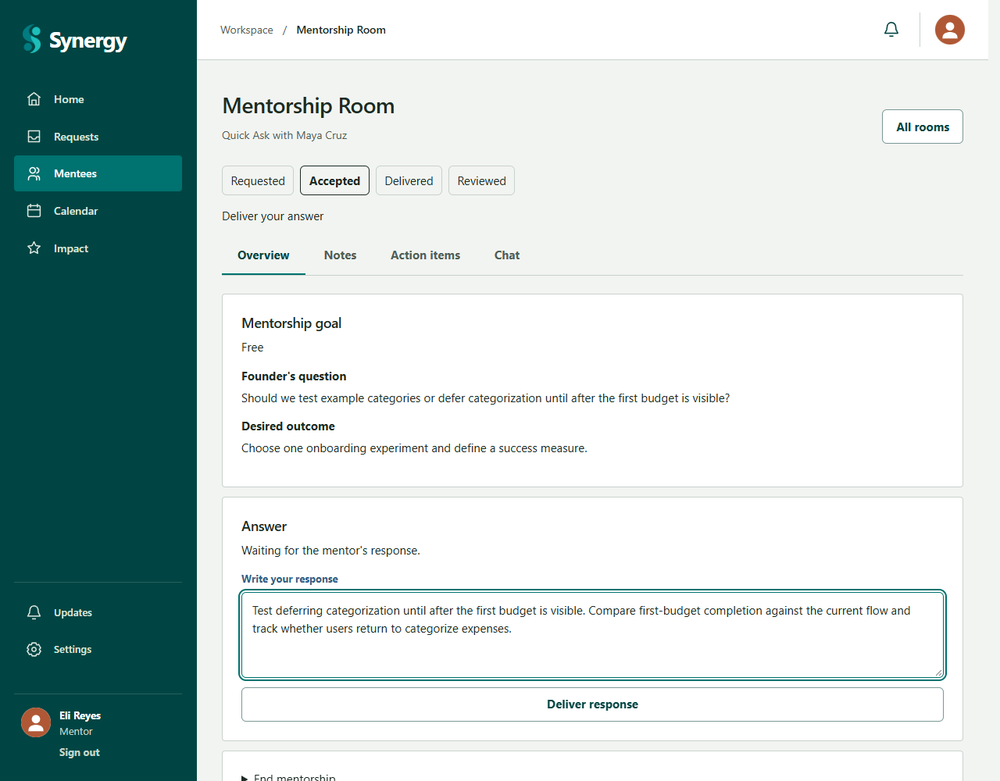

The stage indicator identifies **Accepted**, and the instruction **Deliver your answer** explains which role must act. The mentor can refer to the question and desired outcome while composing the reply.

**Figure 8. Startup founder — The shared room at Delivered**

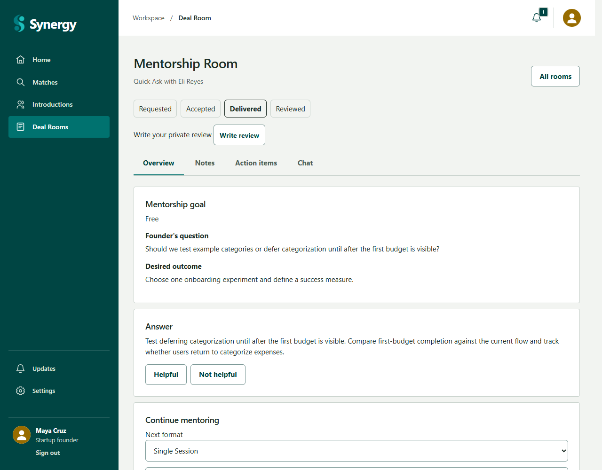

The founder sees the saved response, the current stage, and two ways to record whether the answer helped. The separate **Write review** action signals that engagement feedback is a separate task.

Appendix C shows the mentor’s saved private submission and the founder’s view after both reviews are released.

## 5. Design Rationale and HCI Principles

Nielsen’s (1994) heuristics inform the interpretation of the interface decisions. **Visibility of system status** is central to the request handoff. After a founder submits a request, **Introductions** shows its `pending` state and expiry. After acceptance, the link to the room appears alongside `accepted`. Once the mentor delivers, both users see **Delivered** and the saved answer. This sequence gives each user the information needed to decide whether to wait, withdraw, open the room, or act on a response.

**Recognition rather than recall** is supported by carrying the founder’s inputs from the request form to the inbox and retaining the question and goal in the room. The mentor can reread what the founder already tried before committing. The founder can read the answer beside the original question. **Consistency and match with real-world work** are supported by stable labels such as **Quick Ask** across the match profile, request, and room, while the two navigation menus emphasize the work each role comes to do.

**Error prevention and user control** are supported by field validation, the visible request-quality checklist, and server-side capacity checks. The founder can withdraw a pending request. A mentor who reaches capacity receives a recovery path to mentoring settings and can consider declining or referring the request. Referral suggestions go back to the founder, who decides whether to send a new request and what to share. The private-review flow also withholds partner ratings during one-sided submission, giving each person room to evaluate independently.

**Accessibility** is supported by labeled form controls, status announcements, a skip link, visible textual states, and keyboard focus management on route changes. The application uses text to distinguish stages alongside visual emphasis. Scoped automated checks are reported in the evaluation chapter. [Evidence needed: keyboard-only and screen-reader walkthroughs for founder request submission, mentor request triage, and room delivery, with issues and retest outcomes.]

## 6. System Architecture / Technical Design

The frontend uses React, JavaScript, and CSS, with Vite for development and building. The custom Node.js API handles account sessions, matching, authorization, request processing, and room commands. The server validates commands against role, participant membership, and current state. It persists workspace data in SQLite by default and stores uploaded files alongside the database. In the two-account workflow, acceptance associates the same room identifier with the founder and mentor. Delivery persists the answer and advances the room stage. Visible clients refresh workspace state through periodic HTTP requests, including updates triggered by the other role.

**Figure 9. Runtime architecture of the local MVP**

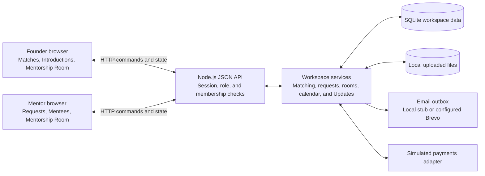

Ordinary local accounts use password verification with salted scrypt hashes. Session tokens are scoped to the tab and can survive a page refresh. The frontend and API can be served together locally. The repository also contains Netlify and Render configuration. A standalone static frontend cannot persist room activity without access to the API.

## 7. MVP Status and Limitations

- **Working locally.** Discovery, structured free mentoring, request decisions, room delivery, and saved activity run in the workspace. Approval, referral, capacity recovery, and blind review visibility were also checked by targeted Chromium tests. The supported synchronous formats provide scheduling and room controls for recording what happens in a session. The meeting itself uses an external call link.
- **Partially implemented or externally dependent.** Email has a local outbox and a configurable Brevo adapter. The verified workspace used the stub, and live deliverability and hosted operation remain unverified. Fit scores are explainable heuristics. Their relationship to real engagement outcomes remains unmeasured.
- **Simulated.** **Prototype role** sign-in and **Simulate acceptance** use test identities or fictional counterparts. Paid mentoring includes simulated checkout, payout, and refund states. The paired Quick Ask walkthrough used two independent ordinary local sessions with prepared test profiles.
- **Planned.** The v1.1 implementation record lists live payment-provider integration and release checks as future work. The architecture roadmap describes a possible Supabase migration. The reviewed application uses the Node.js and SQLite workspace.

[Evidence needed: if a hosted MVP is submitted, provide the deployment URL, verified commit, test date, and panel access instructions.]

# PRIOR ARTS

## Prior Art 1 – Micromentor

Micromentor connects entrepreneurs seeking business guidance with volunteer mentors. Its entrepreneur-facing materials describe creating a profile, finding a mentor, initiating a conversation, and applying the advice. Its mentor-facing materials emphasize relevant experience, control over availability, and the ability to share notes and set action plans. This model shows how direct contact and flexible commitment can serve both sides of a business mentorship. The reviewed guides describe how participants engage and follow up, while leaving the interface for timed, format-specific request decisions unspecified (Micromentor, n.d.-a, n.d.-b).

## Prior Art 2 – GrowthMentor

GrowthMentor serves people seeking help with growth and related startup problems. Its help center describes profile matching, browse filters, and a session request that explains the user’s problem and prior attempts. The mentor can accept, suggest another time, or decline. GrowthMentor also documents a visible session lifecycle from **Requested** through **Reviewed** and a way to reconnect after a review (GrowthMentor, n.d.-a, n.d.-b, n.d.-c). These patterns closely overlap with Synergy’s structured intake and visible progress. The reviewed workflow focuses on calls. Synergy’s **Quick Ask** comparison concerns a narrower case in which the deliverable is a written answer in a room.

## Prior Art 3 – ADPList

ADPList offers one-to-one career mentoring across fields such as design, product management, and engineering. Its FAQ describes vetted mentor profiles, published availability, direct calendar booking, and reviews (ADPList, n.d.). Its mentor dashboard announcement describes a mentee directory, notes history, booking controls, and activity summaries (Lee, 2021). These are precedents for giving mentors a workspace for managing relationships and reviewing their contributions. Its primary setting is professional development, while Synergy’s representative task begins with a decision about an early-stage startup’s product.

## Prior Art Comparison Matrix

**Table 1. Comparison of prior arts and proposed system**

| Characteristics / features | Micromentor | GrowthMentor | ADPList | Synergy MVP |
| --- | --- | --- | --- | --- |
| Discovery and fit | Browse entrepreneur or mentor profiles and initiate contact. | Browse by filters or use AI-assisted recommendations. | Review mentor backgrounds, activity, and reviews before booking. | **Matches** provides a rule-based score and fit explanation from profile signals. |
| Intake and mentor decisions | Direct connection and discussion around business goals. | Structured session request with accept, suggest another time, or decline. | Book an open slot from a mentor’s calendar. | Structured request showing expiry, with **Accept**, **Decline**, and **Refer**, subject to capacity. |
| Written guidance and follow-up | The mentor guide describes notes and action plans. | Session chat and a call lifecycle with reviews and reconnection. | Notes history and mentee directory linked to bookings. | **Quick Ask** and **Doc/Pitch Review** make written delivery an explicit room event. Scheduled formats include follow-up controls. |
| Mentor workload and progress | Mentors choose their availability and how many people to support. | Mentor availability and visible session stages. | Calendar limits, mentee history, and dashboard summaries. | **Pause Mode**, capacity settings, **Requests**, stage-based **Mentees**, and **Impact**. |
| Usability / accessibility evidence | Reviewed documentation describes the workflow. Comparative measurement is pending. | Reviewed documentation describes the workflow. Comparative measurement is pending. | Reviewed documentation describes the workflow. Comparative measurement is pending. | Scoped checks include automated accessibility scans and responsive-layout assertions. Task-based usability evidence is pending. |
| Target-user fit | Entrepreneurs and volunteer business mentors. | Growth practitioners, founders, and specialist mentors. | Professionals seeking career guidance and experienced mentors. | Early-stage startup founders and mentors with aligned expertise, format, and capacity. |

*Note.* The comparison uses the official materials cited above and local implementation evidence for Synergy. Descriptions are limited to the reviewed workflows. The matrix is a feature comparison and provides no direct comparative performance measurements.

## Synthesis and Project Gap

The prior arts demonstrate substantially overlapping practices, including profile-based discovery, structured session requests, calendar control, written notes, and post-engagement reviews. The gap Synergy targets is a startup-specific workflow that lets a founder carry a focused request from an explained match through a mentor’s capacity-aware decision to a retained written deliverable. The application also places founder-to-founder exchanges in the same workspace. Micromentor’s action plans, GrowthMentor’s session lifecycle, and ADPList’s mentor dashboard show that several parts of this design have established precedents.

For Synergy, the evidence for this combination includes the linked request and room states in Figures 3–8, the request and room test cases, and the code for capacity and format-dependent actions. The feature review supports this description of the project’s scope. Whether this workflow reduces coordination effort or improves follow-through requires observation with founders and mentors doing comparable tasks.

# EVALUATION AND STAKEHOLDER FEEDBACK

## 1. Evaluation Objectives

The completed technical checks examined functional correctness, persistence, status visibility, and selected recovery and accessibility conditions. They tested whether the request moved between two authorized accounts, whether each role saw the corresponding next action, and whether the answer remained available after the founder reopened the room. The proposed formative study will examine independent completion, status comprehension, workload decisions, and perceived clarity for both roles.

## 2. Evaluation Method and Participants

The current manuscript draws on a browser walkthrough using fictional data, automated unit and integration tests, targeted Chromium tests with selected accessibility scans, and internal issue records. The walkthrough on November 19, 2026 used Google Chrome, an isolated SQLite file, and two independent local sessions. Fixture profiles were prepared through the local API. The founder’s submission, the mentor’s decision and answer, and the founder’s retrieval were performed in the interface. The capture environment used the repository’s isolated browser-test server with mentor approval disabled for the paired walkthrough. The separate onboarding regression used approval-enabled configuration. Fictional account names and demonstration inputs describe test data.

The October 16 invitation describes a BA 234 survey and possible later feedback on the CIT 213 prototype (Team JuMoKu JoJu, 2026). Participation and completed instruments remain unverified. [Evidence needed: verified participation by role, recruitment and consent records, session dates, devices, facilitator, and tested build.]

**Proposed evaluation as future work.** Recruit early-stage founders and mentors with domain or program experience. With consent, ask each person to perform role-specific tasks using test data. For the paired handoff, use either two participants or a facilitator acting as the other role, and record which arrangement was used. Capture independent and assisted completions separately. Ask each user to explain the current status before moving to the next task. Appendix A provides a proposed observation instrument.

## 3. Evaluation Tasks / Instruments

**Table 2. Tasks and technical instruments used**

| ID | Role represented | Task or check | Instrument |
| --- | --- | --- | --- |
| T1 | Startup founder | Identify a suggested mentor, complete the Quick Ask, and locate its `pending` state. | Local browser walkthrough and Figures 3–5. |
| T2 | Mentor | Read the founder’s context and choose how to respond. Check a referral and a blocked acceptance in separate scenarios. | Local browser walkthrough, Figures 6 and C3, and [mentor request browser tests](tests/mentor-requests.spec.js). |
| T3 | Mentor | Open the accepted room and deliver a written response. | Local browser walkthrough, Figure 7, and [Quick Ask browser test](tests/mentor-room.spec.js). |
| T4 | Startup founder | Open the accepted room and verify that the written answer appears at **Delivered**. Recover from an unavailable mentor link in a separate scenario. | Local browser walkthrough, Figure 8, and [mentor request browser tests](tests/mentor-requests.spec.js). |
| T5 | Mentor and startup founder | Verify first-submit privacy and release after the second account submits. | Local browser walkthrough, supplementary captures in Appendix C, and [Quick Ask browser test](tests/mentor-room.spec.js) for one-sided review privacy. |
| T6 | Mentor as applicant, founder as directory viewer | Resume a saved application and verify that the mentor becomes discoverable after approval. | [Mentor onboarding browser test](tests/mentor-onboarding.spec.js). |

The repository’s [manual test-case runthrough](docs/testing/TEST-CASE-RUNTHROUGH.md) provides expected outcomes for additional tasks. Appendix A lists the proposed prompts and measures for sessions with people.

## 4. Results and Findings

The founder submitted a Quick Ask, and **Introductions** displayed `pending` with a response window. The mentor’s separate **Requests** inbox displayed the submitted context and available decisions. Acceptance gave both accounts access to the same room. After **Deliver response**, the mentor saw the saved text and **Delivered**. The founder subsequently reopened the room and saw the same answer and the feedback controls. A follow-on check confirmed that the mentor’s first review was saved, the founder still saw the private review form, and both accounts saw the counterpart’s feedback after the second submission. These observations support Objectives 1–3 for the local fixture scenario.

On November 19, 2026, the build succeeded, all 190 unit and integration tests passed, and all five selected Chromium tests passed. The targeted cases covered mentor application and discovery, referral, capacity-blocked acceptance and recovery, recovery from an unavailable mentor link, and asynchronous delivery with review privacy. The targeted onboarding, referral, and Quick Ask tests include scoped axe checks. The suite also includes layout checks at several viewport widths on selected screens. These findings describe the checked routes, states, and fixtures.

**Table 3. Internal observations, implemented revisions, and verification**

| Evidence | Observation | Revision and verification |
| --- | --- | --- |
| Internal issue S-04 | A mentor who reached capacity could see the blocked acceptance without a clear route to resolve it. An unavailable mentor link also lacked suitable alternatives. | Implemented a path to **mentoring settings** and an alternative-mentor recovery path. Both browser checks passed in the targeted run. |
| Internal issue S-05 | The founder’s empty **Your introductions** section could appear to contradict the separate pending mentorship request. | Implemented the more specific message “No pending introductions for founder exchanges.” The founder’s pending capture shows the two areas. |
| Internal issue S-11 | An accepted async room originally assigned the mentor’s delivery instruction to the founder. | Implemented different next-action text for each role. The Quick Ask browser test checks the founder’s waiting message and the mentor’s **Deliver your answer** instruction. |

The observations in Table 3 are internal development findings documented in the [issue log](BUGLOG.md). [Evidence needed: a dated, anonymized founder or mentor stakeholder observation, the task and screen involved, the resulting revision or reason for deferral, implementation status, and any retest result.] [Evidence needed: role-level completion and assistance counts, task times, observed errors, status-comprehension responses, and anonymized interview themes.]

## 5. Evaluation Limitations

The paired walkthrough covered a free request with prepared profiles and a single successful answer. Browser regressions use deterministic fixtures and sometimes prepare state through the API. They establish behavior under the exercised conditions. The current run did not establish how independently founders or mentors can discover their actions, how accurately they interpret match scores, or whether the advice leads to follow-through.

Automated accessibility checks have limited coverage. Keyboard-only and assistive-technology testing with people, testing on physical mobile devices, and hosted-service verification remain pending. A prior full-suite run documented in the issue log reported one WebKit notification-dismissal timeout in the combined run that passed in isolation. The current targeted run used Chromium. Live payment, external email delivery, and long-term mentoring outcomes were outside the tested scope.

# CONCLUSION AND RECOMMENDATIONS

## 1. Summary

Synergy addresses the handoff between finding someone with relevant expertise and carrying out a bounded mentorship task. Founders can express a need, inspect fit, and follow a request through to a written answer. Mentors can review the founder’s context and expected commitment, exercise discretion about accepting the request, and deliver and revisit their contribution in a shared room. The local walkthrough and automated checks exercised both roles and selected recovery paths.

## 2. Conclusion

The local MVP provides a working founder-to-mentor exchange for a free **Quick Ask**. The two participants have different controls and instructions, while the request, room identity, and written answer remain linked. The technical evidence establishes that this workflow can be demonstrated and that the documented recovery and review behavior works under tested conditions. Learnability, satisfaction, real-world match quality, and the effectiveness of the advice remain open questions. Objective 4 remains pending until intended users take part in an evaluation.

## 3. Recommendations / Future Improvements

1. Conduct the paired formative evaluation in Appendix A. Examine whether founders understand the fit explanation and request status, and whether mentors understand the scope, deadline, and consequences of their decision. Tie observed problems to revisions and repeat the affected tasks.
2. Test both role paths with keyboard navigation and a screen reader, and repeat the flow on a physical phone. Include the blocked acceptance, referral, and one-sided review states.
3. Reproduce the full-suite WebKit issue and complete the panel setup check from a clean workspace. If hosted access or live integrations become part of the submission, verify those paths independently of local preview and simulated checkout.

# REFERENCES

ADPList. (n.d.). *Frequently asked questions*. Retrieved November 19, 2026, from [ADPList FAQs](https://adplist.org/faqs).

Amaguin, J. J., Dayao, K. D. G., Hermosura, M. J. C., Japitana, J. A., & Moje, J. C. (2026, September). *Synergy: Matchmaking and execution platform for startup collaboration* [Unpublished midterm project documentation]. West Visayas State University. [Project concept document](docs/product/Synergy.pdf)

Department of Science and Technology Regional Office VI. (2025, April 11). *Ad hoc committee to boost regn’l startup development formalized, outlines key action plan components*. [DOST Region VI](https://region6.dost.gov.ph/2025/04/11/ad-hoc-committee-to-boost-regnl-startup-development-formalized-outlines-key-action-plan-components/)

GrowthMentor. (n.d.-a). *How do I book a call?* Retrieved November 19, 2026, from [GrowthMentor booking guide](https://www.growthmentor.com/faq/scheduling-a-session-with-a-mentor).

GrowthMentor. (n.d.-b). *How do I find the right mentor on GrowthMentor?* Retrieved November 19, 2026, from [GrowthMentor discovery guide](https://www.growthmentor.com/faq/two-ways-to-find-a-mentor).

GrowthMentor. (n.d.-c). *What are the stages of a GrowthMentor session?* Retrieved November 19, 2026, from [GrowthMentor session stages](https://www.growthmentor.com/faq/stages-of-a-session).

Lee, F. (2021, September 9). *Impact, by design — Introducing a new mentor dashboard*. ADPList. [ADPList mentor dashboard announcement](https://adplist.org/blog/impact-by-design)

Micromentor. (n.d.-a). *Become a mentor*. Retrieved November 19, 2026, from [Micromentor mentor guide](https://micromentor.org/mentors).

Micromentor. (n.d.-b). *Become an entrepreneur*. Retrieved November 19, 2026, from [Micromentor entrepreneur guide](https://micromentor.org/entrepreneurs).

Nielsen, J. (1994, April 24). *10 usability heuristics for user interface design*. Nielsen Norman Group. [Usability heuristics](https://www.nngroup.com/articles/ten-usability-heuristics/)

Team JuMoKu JoJu. (2026, October 16). [Survey invitation and notice of potential prototype feedback]. West Visayas State University. See Appendix E.

West Visayas State University, College of Information and Communications Technology. (2026a). *CIT 213 – Human-Computer Interaction 2: Final project requirements and documentation guidelines* [Course handout].

West Visayas State University, College of Information and Communications Technology. (2026b). *Final project document* [CIT 213 manuscript template].

# APPENDICES

## Appendix A – User research instruments

**Available research material.** The October 16 invitation identifies the proposed collaboration-needs survey and the possibility of later CIT 213 prototype feedback. [Evidence needed: a dated copy of the survey questions as distributed, any CIT 213 interview guide actually used, and the anonymized responses, if collected.]

**Proposed task observation instrument for future use**

| ID | Role | Prompt given to the participant | Success criterion |
| --- | --- | --- | --- |
| A1 | Startup founder | Find a mentor who could advise your team on improving onboarding. Explain why you would approach that person. | Identifies an eligible mentor and explains a relevant profile or fit signal in their own words. |
| A2 | Startup founder | Ask that mentor for written advice. Then explain what Synergy says will happen next. | Sends a Quick Ask with sufficient context and correctly explains the pending state and available choices. |
| A3 | Mentor | A founder has asked about onboarding. Determine what is being asked and decide whether to take it. | Identifies the format, scope, response deadline, and chosen decision. Can explain what the founder will see. |
| A4 | Mentor | You have decided to take the request. Leave a written recommendation and verify that it was delivered. | Submits the recommendation in the correct room and identifies the saved answer and **Delivered** stage. |
| A5 | Startup founder | Find the recommendation and explain what you would do next. | Retrieves the saved answer, explains it in their own words, and identifies the relevant follow-up or feedback control. |

For each task, record role, participant code, starting state, elapsed time, independent completion, assisted completion or failure, assistance provided, visible errors, and the participant’s interpretation of the status. Ask founders what made the mentor seem suitable and how they knew the answer was ready. Ask mentors what information aided their decision and whether the consequences of accepting, declining, or referring were clear. For paired tasks, record who controlled the other session.

## Appendix B – Stakeholder feedback summaries or anonymized evidence

The [issue log](BUGLOG.md), [internal UX review](docs/archive/UI-UX-REVIEW.md), and [stakeholder-readiness review](docs/archive/STAKEHOLDER-READINESS.md) document development findings and preparation for feedback. Table 3 identifies technical observations, the implemented revisions, and relevant retests. The archived readiness assessment records readiness for a guided session on an earlier build.

[Evidence needed: anonymized feedback records from actual founders and mentors. For each observation, include the date, participant role, task, issue, related evidence, change or deferral decision, implementation status, and retest outcome.]

## Appendix C – Additional interface screens and user-flow diagrams

The [original user-flow graphic](docs/product/references/original-user-flow.png) and [September concept documentation](docs/product/Synergy.pdf) show the early design. Figure 2 documents the current paired Quick Ask flow and Figures 3–8 show the main exchange. Figures C1 and C2 show the review follow-on with demonstration values.

**Figure C1. Mentor — Private mentorship review after submission**

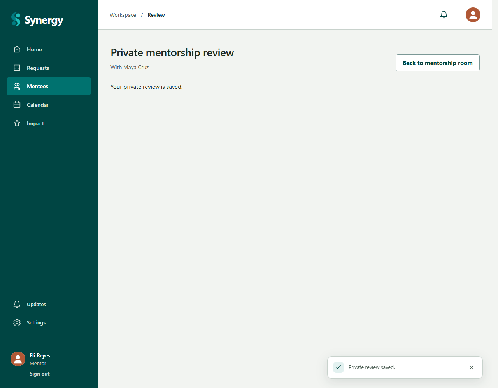

The confirmation tells the mentor that feedback has been saved. At this point the founder can still submit an independent review. The review form explains the release rule before submission.

**Figure C2. Startup founder — Mentorship feedback after both reviews are submitted**

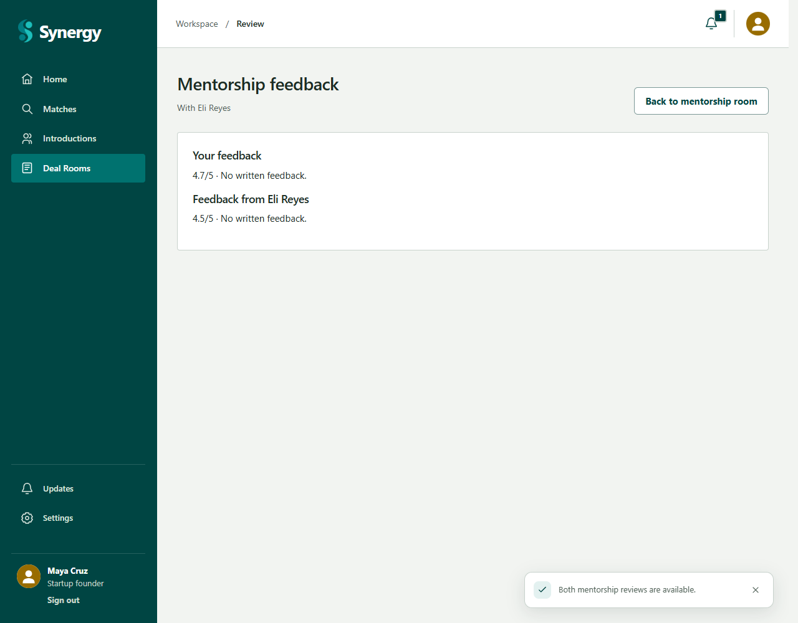

The founder sees the mentor’s feedback after the second submission. The mentor’s corresponding page shows the founder’s feedback. The ratings in this capture are test inputs used to verify review release.

**Figure C3. Mentor — Requests after a capacity-blocked acceptance**

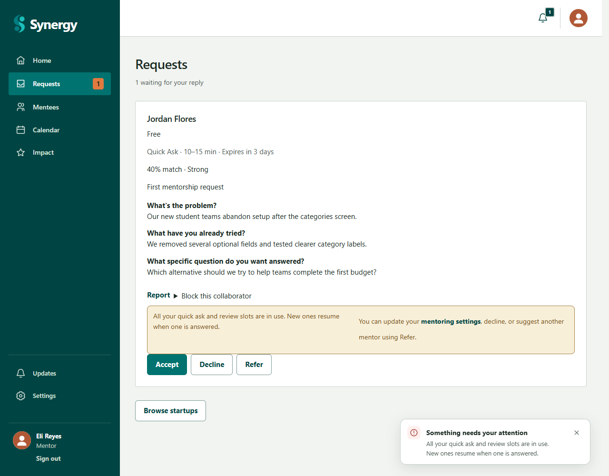

This separate fixture has a mentor with one active written engagement and a limit of one. The attempted acceptance leaves the second request in **Requests**, where the mentor can open **mentoring settings**, **Decline**, or **Refer**. The page preserves the request context while the mentor decides how to proceed.

## Appendix D – User guide / MVP access and setup instructions

**Local setup**

1. From the repository root, install the project dependencies with Node.js 24 or later and npm. Use `npm ci` for the checked-in lockfile. On Windows PowerShell use `npm.cmd` if needed.
2. Start an isolated local workspace in PowerShell with the commands below. Open the displayed local URL, typically `http://localhost:5173`.

```powershell
npm.cmd ci
$env:SYNERGY_DEMO_MODE = 'false'
$env:SYNERGY_DATA_FILE = ".data/panel-demo-$([guid]::NewGuid()).sqlite"
$env:SYNERGY_ADMIN_EMAILS = 'panel-moderator@example.com'
npm.cmd run dev
```

3. Open independent browser profiles or independently opened tabs. Use **Create an account** to prepare a **Founder**, a **Mentor**, and a moderator account using the configured moderator address. Use fictional profile information and distinct local account credentials.
4. For the mentor, complete **Mentor application**, accept the guidelines, include **Quick Ask** among the offered formats, and select **Submit for approval**. In the moderator workspace, open **Moderation** and select **Approve mentor** for the correct account. Check the mentor’s **Settings** → **Mentoring** for the offered format and available capacity. In the founder profile, enter a need that overlaps with the mentor’s expertise so the mentor can be found in **Matches**. The [README](README.md) and [manual walkthrough](docs/testing/TEST-CASE-RUNTHROUGH.md) provide additional setup and recovery guidance.

**Paired Quick Ask demonstration**

1. As founder, open **Matches**, view the mentor’s match detail, and review the match explanation. In **Request mentorship**, describe the problem and prior attempts, enter a specific question, select **Quick Ask**, and choose **Send mentorship request**. In **Introductions**, check that the request is `pending`.
2. As mentor, open **Requests**, read the founder’s submission, and select **Accept**. In the **Mentorship Room**, write a response under **Answer** and choose **Deliver response**. Check that the response is saved and the stage is **Delivered**.
3. As founder, return to **Introductions** and choose **Open mentorship room** on the `accepted` request. Read the saved **Answer** at **Delivered**. To demonstrate the review step, use **Write review** from each account and observe that feedback is private during one-sided submission.
4. For a single-person demonstration, restart with `SYNERGY_DEMO_MODE=true` and a different database file. Choose a **Prototype role**, enter made-up credentials, and use **Simulate acceptance** where available for a fictional counterpart. Use the paired setup to demonstrate what the other account can actually see and do.

**Optional source verification**

```powershell
npm.cmd run build
npm.cmd run test:unit
npx.cmd playwright install chromium
npm.cmd run test:e2e -- --project=chromium tests/mentor-requests.spec.js tests/mentor-room.spec.js tests/mentor-onboarding.spec.js
```

[Evidence needed: the submitted repository snapshot or verified panel access link, together with the approved demonstration setup.]

## Appendix E – Consent or supporting documents, where applicable

The supplied `PROJECT OVERVIEW.pdf` and `TEMPLATE.pdf` contain the course requirements and manuscript structure (West Visayas State University, College of Information and Communications Technology, 2026a, 2026b). The team’s October 16 invitation, `Synergy_Survey_Invitation_Letter_JuMoKuJoJu.pdf`, mentions voluntary participation and academic use.

[Evidence needed: the participant information sheet and consent form used for the evaluation, any separate recording consent, applicable course approval, and the agreed data-handling procedure. Attach blank forms or appropriately anonymized evidence.]

## Appendix F – Full-text prior arts or permitted supporting materials, as required

The References section links to the complete public materials used for Micromentor, GrowthMentor, and ADPList. The prior-art summaries and Table 1 provide the supporting comparison. Reproduction permission for the external pages has not been verified. [Evidence needed: any instructor-required copies of prior-art materials whose reproduction is permitted.]

# SEPARATE REQUIRED DELIVERABLE 1 – UPDATED SYSTEM DOCUMENTATION

Submit a separate revised version of the midterm system documentation. The [September concept document](docs/product/Synergy.pdf), the [current documentation index](docs/README.md), and the [test-case runthrough](docs/testing/TEST-CASE-RUNTHROUGH.md) can support the revision. The separate file should include updated personas, scenarios, user flows, wireframes, current screenshots, implementation progress since midterms, methods and actual test results, and stakeholder feedback with a revision log.

[Evidence needed: the final updated midterm documentation file, reconciled with the manuscript and demonstrated build, and proof of separate submission.]

# SEPARATE REQUIRED DELIVERABLE 2 – MVP

Submit a runnable copy of the application or an accessible deployment, with setup instructions, a brief user guide, and screenshots of its major functions. The current repository supports a local demonstration of the paired workflow. Appendix D provides the guide. The reviewed source revision was `b25350f`. A submission copy or hosted panel-access link is pending verification.

# FINAL SUBMISSION CHECKLIST

| Status | Template requirement | Verified basis or outstanding item |
| --- | --- | --- |
| [x] | Final Project Document follows the supplied CIT 213 structure. | Headings, numbered subsections, appendices, and separate-deliverable notices are present. |
| [x] | Proposed title, problem, implementation, user flow, and prior arts are included. | Main sections, Figures 1–9, and Table 1 are present. |
| [x] | At least three relevant prior arts are reviewed and compared. | Micromentor, GrowthMentor, and ADPList are compared using their official materials. |
| [ ] | Evaluation phase and actual stakeholder feedback are documented. | Technical evaluation is documented. Anonymized stakeholder records are outstanding. |
| [ ] | Revisions based on evaluation are explained. | Internal revisions and retests are documented in Table 3. Stakeholder-linked revisions remain unverified. |
| [ ] | Updated midterm system documentation is submitted separately. | The final separate file and submission status are unverified. |
| [x] | MVP is accessible and ready for demonstration. | The local build ran and the paired Quick Ask was demonstrated. Hosted or panel access remains unverified. |
| [ ] | Manuscript, system documentation, and MVP are consistent. | Manuscript and local build were checked. The separately updated midterm file remains outstanding. |
| [ ] | References, captions, tables, and appendices are complete. | References, captions, and tables are present. The appendices identify outstanding research evidence and any required permitted source copies. |
| [ ] | All materials are submitted by November 27, 2026. | The date is from the CIT 213 course brief. Submission remains unverified. |


