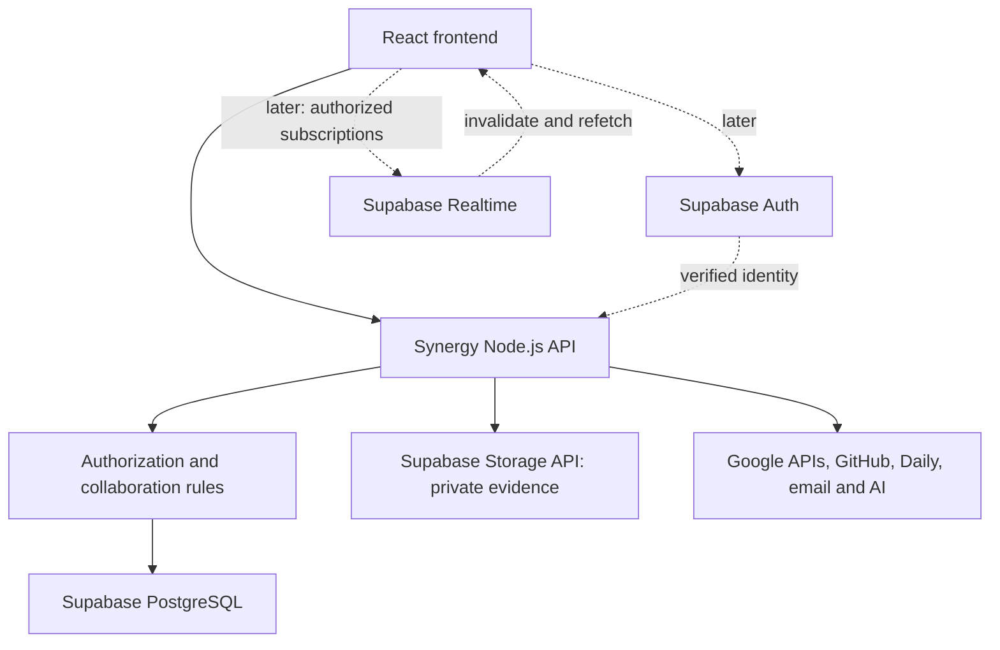

> Proposed architecture plan, separate from delivered UX polish. The inventory below is its planning snapshot; see the [current README](../../README.md) for implemented local prototype behavior.

# Synergy: Supabase Migration and API Implementation Roadmap

Created: October 27, 2026  
Status: Proposed roadmap; implementation has not started  
Recommended approach: Keep React and the Node.js API; introduce Supabase PostgreSQL and Storage first, then consider Supabase Auth and Realtime.

## 1. Intended outcome

Move Synergy's persistent data and evidence files to managed cloud services while preserving its collaboration rules. The team should be able to run the same app against a shared hosted backend and demonstrate that records survive application restarts and redeployments.

The first release should deliver:

- [ ] PostgreSQL persistence hosted by Supabase.
- [ ] Private evidence attachments through the Supabase Storage API.
- [ ] Existing account, discovery, introduction, room, milestone, review, moderation, and notification workflows working on the new storage.
- [ ] A repeatable migration, verification, backup, and recovery process.
- [ ] An API explanation and reliable presentation journey.

Later releases may add:

- [ ] Supabase Auth for identity and session management.
- [ ] Supabase Realtime for authorized room and chat updates.
- [ ] Selected Supabase Data API reads with explicit database access policies.
- [ ] Google Calendar, Google Tasks, Google Forms, GitHub, and Daily integrations, in that priority order.

Supabase hosts backend infrastructure and exposes APIs. It does not automatically implement Synergy's matching algorithm, mutual approvals, blind reviews, or external-provider authorization.

## 2. Current implementation and migration implications

| Area               | Current source                                                                       | Migration implication                                                                                                                                                         |
| ------------------ | ------------------------------------------------------------------------------------ | ----------------------------------------------------------------------------------------------------------------------------------------------------------------------------- |
| HTTP API           | [server/api.js](../../server/api.js)                                                       | Preserve existing `/api/*` behavior during the database migration; await all new asynchronous repository operations.                                                          |
| Persistence        | [server/storage.js](../../server/storage.js)                                               | SQLite stores serialized account/meta records in a generic `records` table, rather than separate relational tables for rooms and messages. This requires data transformation. |
| Workspace logic    | [server/workspace.js](../../server/workspace.js)                                           | Loads a workspace into memory and commits snapshots synchronously. Replace this as the authoritative data source with transaction-based database operations.                  |
| Shared rooms       | [server/workspace.js](../../server/workspace.js)                                           | Room data is mirrored between accounts with participant-relative `me` and `partner` fields. Convert it into canonical room records and participant-specific rows.             |
| Authentication     | [server/workspace.js](../../server/workspace.js), [server/accounts.js](../../server/accounts.js) | Uses scrypt passwords, process-memory sessions, and custom email challenges. Keep this working during the first migration; changing identity providers is a separate phase.   |
| Files              | [server/api.js](../../server/api.js), [server/files.js](../../server/files.js)                   | Local uploads require membership checks, file inspection, and limits. Preserve these checks around Supabase Storage operations.                                               |
| Extended workflows | [server/features.js](../../server/features.js)                                             | Preserve moderation, affiliations, vocabulary, versioned templates/weights, recovery, scheduling, and digest behavior.                                                        |
| Frontend state     | [src/state/AppContext.jsx](../../src/state/AppContext.jsx)                                 | Uses tab-scoped sessions and approximately 1.5-second polling. Preserve the API response contract first; optimize synchronization later.                                      |
| Serialization      | [src/state/serialization.js](../../src/state/serialization.js)                             | Existing snapshots contain serialized Sets. Import with the existing decoder and map them to rows or arrays.                                                                  |
| Backups and health | [server/backup.js](../../server/backup.js), [server/operations.js](../../server/operations.js)   | Local file backups/readiness checks need cloud equivalents covering both database records and actual object bytes.                                                            |

The existing project describes a single-server prototype. Moving its snapshots to a remote database alone would not make it safe to run multiple application instances.

## 3. Recommended architecture

### Access strategy

1. **Database migration:** Node connects to PostgreSQL using a dedicated application database role and a connection pool. Application tables start in an unexposed schema. The Node API authenticates each request and checks access inside the operation's transaction.
2. **Storage migration:** Node calls the Supabase Storage API with a server-only secret after validating the user and room. The React app continues using `/api/upload` and `/api/files/:id`.
3. **Optional Auth adoption:** Node validates Supabase user tokens and maps their identities to existing application account IDs.
4. **Optional Data API/Realtime adoption:** Add only the required user-scoped reads and subscriptions after grants, Row Level Security (RLS), and privacy tests pass. Collaboration mutations continue through trusted transaction-based commands.

Use `pg` or an equivalent PostgreSQL driver for multi-statement transactions. Use `@supabase/supabase-js` for Storage, optional Auth, and optional Realtime/Data API access. Several separate REST calls do not form one atomic database transaction.

Supabase supports direct database connections, poolers, and Data APIs. Choose the connection mode appropriate to the Node host and its IPv4/IPv6 support. Start with a small bounded pool; use the project's actual connection limits. [Connection documentation](https://supabase.com/docs/guides/database/connecting-to-postgres)

## 4. Non-negotiable behavior to preserve

- A room is created only after mutual consent; duplicate acceptance cannot create duplicate rooms.
- Each account can maintain founder and mentor profiles, with the correct role attached to each engagement.
- Terms updates require the observed revision. A stale update returns a conflict without overwriting newer data.
- Confirmations reference the exact milestone content version. Evidence, scope, schedule, or agreement changes invalidate affected confirmations.
- Pending scope changes and unresolved disputes block completion as they do today.
- Reviews remain private until both participants submit. Public reputation must preserve the distinct-partner safeguards.
- Moderators can access only the additional information needed for their authorized workflows; moderation must not expose unreleased partner reviews.
- Suspension, blocking, visibility, account deletion, and shared-record retention keep their existing meanings.
- Old rooms retain their original template, scoring configuration, and agreement history.
- File downloads require access to the associated room or the existing authorized moderation context.
- Failed database or provider operations must not report success or leave a partially completed collaboration action.

## 5. Proposed data model

These are design targets, not tables that already exist. Refine names and columns during Phase 1. Normalize shared entities while keeping immutable template/score snapshots in JSONB where appropriate.

| Domain                          | Proposed tables                                                                     | Rules to carry into the schema                                                                                                     |
| ------------------------------- | ----------------------------------------------------------------------------------- | ---------------------------------------------------------------------------------------------------------------------------------- |
| Accounts and profiles           | `accounts`, `profiles`, `account_preferences`                                       | Stable application account ID; unique account/role profile; optional unique Supabase Auth ID later; visibility and deletion state. |
| Temporary legacy authentication | `legacy_credentials`, `auth_challenges`                                             | Backend-only access; preserve salt/hash format and challenge expiration/guess limits; remove when Auth migration is complete.      |
| Discovery                       | `saved_profiles`, `introductions`, `account_blocks`                                 | Unique saves; role-aware participants; prevent conflicting active introductions while permitting later repeat engagements.         |
| Shared work                     | `rooms`, `room_members`, `room_terms`, `term_approvals`                             | One canonical room; two distinct participant accounts; membership role; explicit agreement revision.                               |
| Milestones                      | `milestones`, `milestone_confirmations`, `milestone_proposals`, `milestone_history` | Composite keys scoped to a room; confirmation uniqueness by participant/version; immutable accepted-change history.                |
| Sessions                        | `mentorship_sessions`                                                               | UTC instant plus original timezone; recurring series identity and reschedule history.                                              |
| Chat and evidence               | `messages`, `evidence_files`, `milestone_evidence`                                  | Immutable IDs and creation order; private object path; upload lifecycle and checksums; historical evidence retained.               |
| Reviews                         | `reviews`                                                                           | One review per room/reviewer; restricted read access until mutual release; release state computed or changed transactionally.      |
| Activity                        | `activity_events`, `notification_reads`, `notification_preferences`                 | Account-scoped read state; preserve current computed reminders and digest preferences.                                             |
| Trust and moderation            | `reports`, `moderation_audit`, `affiliation_requests`, `moderator_memberships`      | Audited decisions; trusted privilege assignment; clear suspension and report-access rules.                                         |
| Vocabulary and configuration    | `tags`, `tag_proposals`, `profile_tags`, `template_versions`, `matching_versions`   | Approval status; immutable versions; room snapshots preserve historical values.                                                    |
| Operations                      | `usage_counters`, `outbox_jobs`, `migration_runs`, `legacy_id_map`                  | Atomic email/AI limits; deduplicated work delivery; resumable import with explicit identity mapping.                               |
| Future integrations             | `integration_connections`, `integration_links`, `integration_jobs`                  | Provider account ownership; encrypted secrets; scopes/expiry; external object IDs; retry and deduplication keys.                   |

Do not populate future-integration tables with invented provider data. Add those tables when their corresponding integration phase begins.

Use foreign keys, unique/check constraints, and indexes for membership, room messages, milestone versions, pending introductions, and due jobs. Convert participant-relative flags into explicit participant IDs. Do not choose one mirrored room copy silently when copies disagree: report and reconcile the conflict during migration.

## 6. Implementation phases

### Phase 0: Establish the baseline and recovery point

**Depends on:** nothing.  
**Suggested owner:** backend developer with QA support.

- [ ] Run the current unit/API tests, browser suite, and production build against disposable data; record the commit and results.
- [ ] Inventory the actual workspace without printing passwords, tokens, emails, or private messages into reports.
- [ ] Decide whether existing accounts/data must migrate or whether an explicitly designated demo environment may start fresh. Default to preserving existing data.
- [ ] Create and verify a backup of the database and uploads using the existing backup tooling.
- [ ] Restore that backup into a separate local directory and test a representative room and evidence download.
- [ ] Record baseline record counts, room IDs, versions, distinct reviews, file sizes, and hashes in a private migration manifest.

**Done when:** there is a tested restore point, a recorded baseline, and an inventory sufficient to verify the import.

### Phase 1: Set up Supabase and define access boundaries

**Depends on:** Phase 0.

- [ ] Create a development Supabase project and choose a suitable region. Use an isolated staging/demo environment before cutover.
- [ ] Set up the Supabase CLI and local development environment; account for the local runtime's container requirements.
- [ ] Add version-controlled SQL migrations under `supabase/migrations/` and test fixtures containing fictional data only.
- [ ] Create the application schema, migration role, and restricted runtime role. Keep internal schemas outside the Data API's exposed schemas.
- [ ] Grant only the operations needed by the runtime role. Do not run routine application queries as the database owner.
- [ ] Create a private `evidence` bucket and confirm anonymous requests cannot list, upload, or download files.
- [ ] Add a validated configuration layer and separate development/staging/production credentials.
- [ ] Review the actual project's database, storage, egress, connection, and Realtime limits.

**Proposed environment variables** (not implemented yet):

| Variable                        | Used by                            | Purpose                                                                                                 |
| ------------------------------- | ---------------------------------- | ------------------------------------------------------------------------------------------------------- |
| `SYNERGY_STORAGE_DRIVER`        | Node                               | Explicit `sqlite` or `supabase` selection during rollout. Never silently fall back after a cloud error. |
| `DATABASE_URL`                  | Node only                          | Restricted runtime PostgreSQL connection string.                                                        |
| `MIGRATION_DATABASE_URL`        | Migration tooling only             | Elevated connection for applying schema changes.                                                        |
| `SUPABASE_URL`                  | Node; browser only if needed later | Project service URL.                                                                                    |
| `SUPABASE_SECRET_KEY`           | Node only                          | Storage/admin service access. Never use a `VITE_` prefix.                                               |
| `SUPABASE_EVIDENCE_BUCKET`      | Node                               | Private evidence bucket name.                                                                           |
| `SYNERGY_AUTH_DRIVER`           | Node                               | Explicit legacy or Supabase identity mode in the later Auth phase.                                      |
| `VITE_SUPABASE_URL`             | React, later                       | URL for optional Auth/Realtime/Data API usage.                                                          |
| `VITE_SUPABASE_PUBLISHABLE_KEY` | React, later                       | Public application identifier; user authorization still requires policies and identity.                 |

Use the current publishable/secret key types. Server secret keys bypass RLS and must never reach browser bundles or logs. An existing Synergy session token is not a Supabase user JWT. [API key documentation](https://supabase.com/docs/guides/getting-started/api-keys)

**Done when:** migrations run on an empty development database, a restricted connection works, and unauthorized database/storage access is denied.

### Phase 2: Refactor persistence and implement PostgreSQL repositories

**Depends on:** Phase 1.

- [ ] Introduce repository boundaries for accounts, profiles, introductions, rooms, files, and moderation.
- [ ] Convert affected workspace methods and HTTP handlers to `async`/`await`, including startup, health checks, digest operations, and shutdown.
- [ ] Replace whole-workspace reads and writes with targeted queries; stop treating process memory as the authoritative shared database.
- [ ] Keep `/api/state` compatible by assembling the existing frontend response shape from relational data. Derive `me`/`partner` fields for the requesting user.
- [ ] Preserve existing error statuses and field validation responses. Return a successful response only after commit.
- [ ] Implement multi-row commands in PostgreSQL transactions: invitation acceptance, terms approval/reopening, milestone revisions, confirmation, launch, review release, blocking, and deletion/anonymization.
- [ ] Bind the acting account to the authenticated Node session; never trust an account ID supplied as proof of identity by the browser.
- [ ] Lock or version-check affected room rows, then recheck membership, block/suspension state, and action eligibility inside the transaction.
- [ ] Use compare-and-update checks for revisions and confirmations. Add database uniqueness constraints to prevent duplicate rooms/reviews under retries.
- [ ] Preserve refresh/revision behavior in the API; introduce account/room revisions if replacing the workspace-wide revision.
- [ ] Write notification/digest work to an outbox in the same transaction as the corresponding change. Retry external delivery separately with deduplication.
- [ ] Retain a single application instance while legacy sessions and in-process scheduling remain. Later horizontal scaling requires durable session handling and job leases.

**Done when:** disposable PostgreSQL tests cover the existing workflows, two concurrent users cannot overwrite each other's work, and a backend restart preserves saved records.

### Phase 3: Migrate evidence to Supabase Storage

**Depends on:** Phase 2 file metadata and room authorization.

- [ ] Replace local disk operations behind the existing upload/download API with Supabase Storage calls.
- [ ] Preserve current content inspection, permitted types, 5 MB per-file limit, and 50 MB per-account accounting, including historical versions.
- [ ] Use immutable object names based on room/file IDs; store original filenames separately.
- [ ] Keep the bucket private. An object path or UUID alone does not authorize access.
- [ ] Initially proxy downloads through Node so current membership/moderator checks run on every request.
- [ ] If signed URLs are introduced later, use short expiry and document that a previously issued URL can remain usable until it expires.
- [ ] Model upload state explicitly: reserve metadata/quota, upload object, then finalize evidence in a transaction that rechecks the observed room/milestone version.
- [ ] Handle failures across the database and Storage API with cleanup/reconciliation jobs. A database rollback cannot roll back an object upload.
- [ ] Import existing bytes and compare their hashes against the migration manifest.
- [ ] Verify backup and restore of both database metadata and object contents.

Server-authorized Storage calls must enforce Synergy's access rules because secret-key calls bypass user policies. Direct browser Storage access, if added later, requires tested bucket/object policies. [Storage access controls](https://supabase.com/docs/guides/storage/security/access-control)

**Done when:** permitted participants can upload/download evidence, other accounts cannot, and failed uploads do not create confirmed evidence or consume quota permanently.

### Phase 4: Import and reconcile existing workspace data

**Depends on:** Phases 2 and 3.

- [ ] Build a dry-run importer using `readWorkspaceSnapshot` and the existing serialization decoder.
- [ ] Import from a verified snapshot, not from an actively changing workspace.
- [ ] Preserve stable IDs where possible; maintain a mapping where relational rows need new IDs.
- [ ] Deduplicate mirrored rooms, messages, terms, milestones, and evidence. Convert approvals and reviews into account-specific records.
- [ ] Reconcile inconsistent copies explicitly. Stop the import for unresolved differences affecting permissions, evidence, approval, or review privacy.
- [ ] Preserve founder/mentor roles, repeated engagements, dates/timezones, deleted identities, suspensions, blocks, read state, and matching/template history.
- [ ] Preserve credential hashes only in the backend-only legacy authentication store. Do not import active in-memory sessions or reusable pending codes; require fresh sign-in/challenges at cutover.
- [ ] Make the importer resumable and idempotent using migration IDs, unique keys, and checkpoints.
- [ ] Compare entity counts, relationship integrity, room versions, released/unreleased reviews, and file hashes.
- [ ] Generate a reconciliation report with no secrets or unnecessary personal content.
- [ ] Rehearse the complete import and verification process at least once in staging.

**Done when:** the import is repeatable, all significant differences are resolved, and imported users can complete representative workflows.

### Phase 5: Cut over database and file storage

**Depends on:** Phase 4 and the mandatory validation gates in Section 8.

- [ ] Freeze writes on the source environment, stop background writers, and take a final verified snapshot.
- [ ] Import the final snapshot into the target and run reconciliation checks.
- [ ] Configure the deployed Node server for Supabase and its real email provider. Keep credentials out of Git.
- [ ] Exercise sign-in, profile editing, matching, an accepted introduction, terms, chat, upload/download, confirmations, and blind review release.
- [ ] Verify database connectivity, object availability, and actionable health errors on the deployed host.
- [ ] Replace local-only backup and readiness tasks with the new cloud-aware procedures.
- [ ] Record the release commit, schema version, backup location, target project, and verification results.
- [ ] Open writes only after these checks pass; keep the source snapshot available for the agreed retention period.

**Rollback rule:** before new target writes, return to the frozen source if validation fails. After target writes begin, do not simply point the app at stale SQLite. Freeze writes, preserve the target database/objects, and either repair forward or run a tested reverse migration that includes every new change. Auth rollback has additional identity implications and belongs to Phase 6.

**Done when:** the hosted app works with Supabase persistence and Storage, and the team has exercised recovery rather than merely documenting it.

### Phase 6: Adopt Supabase Auth (optional separate release)

**Depends on:** stable Phase 5 release. This phase is not required to use Supabase PostgreSQL or Storage.

- [ ] Map each existing application account ID to a unique Supabase Auth user ID. Preserve references to shared work even when an Auth user is removed.
- [ ] Confirm supported password-import formats against current documentation. Do not assume the existing Node scrypt representation can be imported directly. Default to verified invitations/password setup for migrated users if compatibility is not proven.
- [ ] Configure custom SMTP and test delivery to real demo accounts. Supabase's default mail service is limited to authorized team addresses and currently two messages/hour, making it unsuitable for repeated team rehearsals. [Custom SMTP documentation](https://supabase.com/docs/guides/auth/auth-smtp)
- [ ] If using Brevo for Auth email, configure its SMTP credentials separately; the existing Brevo HTTP API key setup is not automatically an SMTP configuration. Existing application digests may continue through the Node email service.
- [ ] Reconcile authentication behavior explicitly: the current app requires password plus a fresh emailed code on configured sign-ins. Supabase email confirmation or ordinary password login does not automatically reproduce this rule. Preserve the requirement through a tested supported design, or agree and document a deliberate product change before switching.
- [ ] Validate token signature, issuer, audience, and expiration in Node. Apply application suspension/block checks independently of a valid Auth token.
- [ ] Verify session revocation and password-reset behavior, including any remaining lifetime of already issued access tokens.
- [ ] Preserve safe account linking; never merge accounts solely because a browser submits an email address.
- [ ] Test profile visibility, email changes, deletion, recovery, and moderator privileges with the new identity mapping.
- [ ] Preserve or deliberately revise tab isolation. The current two-account demo relies on tab-scoped sessions; test the new SDK storage configuration, or use separate browser profiles/contexts for the demo.
- [ ] Retire legacy credential/code paths only after migration coverage and recovery procedures are proven.

**Done when:** new and migrated users can authenticate safely, account controls retain their promised behavior, and no user gains another person's room access.

### Phase 7: Add Supabase Data API reads and Realtime (optional)

**Depends on:** Phase 6, or a separately designed and tested identity bridge. Do not treat legacy session tokens as Supabase JWTs.

- [ ] Select only the read surfaces that benefit from direct access. Keep confidential credentials, integration secrets, and moderation internals unexposed.
- [ ] Configure explicit grants and RLS for any exposed tables/views. Use an appropriately secured view design so a view cannot bypass underlying policies.
- [ ] Test access as anonymous, each participant, an unrelated account, a suspended account, and a moderator.
- [ ] Keep incomplete partner reviews out of direct reads, subscriptions, logs, and broad room payloads.
- [ ] Use authorized private channels for room activity. Send minimal invalidation events and refetch the authorized state through the existing API.
- [ ] Treat Realtime as a notification mechanism, not the authoritative record. Refetch after reconnect and tolerate duplicate, delayed, or missed events.
- [ ] Reduce polling only after reconnect, token refresh, sign-out, and access-revocation behavior are proven.
- [ ] Update the built server's Content Security Policy only for the required Supabase HTTP/WebSocket destinations.
- [ ] Monitor concurrent connections, message volume, and egress against the actual plan.

RLS governs database-row access, while private Broadcast/Presence channels need their own authorization configuration. Test both paths. [Database RLS](https://supabase.com/docs/guides/database/postgres/row-level-security), [Realtime authorization](https://supabase.com/docs/guides/realtime/authorization)

**Done when:** two users receive appropriate updates and neither unauthorized accounts nor unreleased reviews appear in events or queries.

### Phase 8: Implement the team's external APIs

**Depends on:** stable Phase 5 persistence, private integration storage, and provider configuration. Supabase Auth and Realtime are not prerequisites.

| Priority | Integration     | First implementation                                            | Supabase data needed                                                                         | Demonstration gate                                                                      |
| -------- | --------------- | --------------------------------------------------------------- | -------------------------------------------------------------------------------------------- | --------------------------------------------------------------------------------------- |
| 1        | Google Calendar | Create, reschedule, and cancel agreed mentorship sessions.      | Connected account, encrypted provider tokens, scopes/expiry, calendar/event IDs, sync state. | One user creates a session; the linked event updates without duplication.               |
| 2        | Google Tasks    | Export a participant's action item to their own task list.      | Task-list/task IDs, account ownership, link to room/milestone version.                       | Task appears with correct title/date; its completion cannot bypass shared confirmation. |
| 3        | Google Forms    | Connect or create/publish a feedback form and import responses. | Form ID, owner, response IDs, import cursor, authorized summary.                             | Submit via Google Forms and refresh real results inside Synergy.                        |
| 4        | GitHub          | Attach a repository release as evidence.                        | Repository/release IDs, access scope, cached results, retrieved timestamp.                   | Import a real release and preserve the partner approval requirement.                    |
| 5        | Daily           | Create a private meeting for an agreed session.                 | Room name/URL, expiry, session mapping, minimal attendance metadata if needed.               | Two authorized users join and leave; an unrelated user cannot obtain a meeting token.   |

- [ ] Store provider tokens encrypted in backend-only storage; keep the encryption key outside the database and browser.
- [ ] Separate provider account connection from signing into Synergy. Google sign-in alone does not grant Calendar, Tasks, or Forms permissions.
- [ ] Implement OAuth state/PKCE as appropriate, exact callback URLs, refresh/reconnect behavior, disconnect/revocation, and per-user ownership checks.
- [ ] Build real HTTP callback routes; the app's current `#/...` routes are not a substitute for registered OAuth callback endpoints.
- [ ] Use deduplicated jobs and stable external-object links so retries do not create repeated events, tasks, forms, or rooms.
- [ ] Keep provider requests separate from Synergy's frequent workspace polling. Cache reads and use bounded retries/backoff.
- [ ] Publish forms explicitly; use Google Forms for response submission and its API for reading results. Start with manual refresh rather than Pub/Sub watches.
- [ ] Test Google testing-mode token expiry and reconnect demo accounts before the presentation.
- [ ] Configure Daily/Forms embedding permissions and the production Content Security Policy; test the built app on the presentation network.
- [ ] Show an actionable integration error while preserving the core Synergy workflow during provider outages.

Provider limits and setup details must be rechecked when each integration is implemented. See Section 11 for official references.

## 7. Proposed repository changes

These paths describe future work; they are not files created by this roadmap.

| Path                           | Intended responsibility                                                                  |
| ------------------------------ | ---------------------------------------------------------------------------------------- |
| `supabase/migrations/`         | Tables, constraints, indexes, grants, policies, functions, and versioned schema changes. |
| `server/db/pool.js`            | PostgreSQL connection lifecycle, timeouts, and transactions.                             |
| `server/repositories/`         | Domain-specific reads and writes independent of HTTP handlers.                           |
| `server/supabase.js`           | Server-only Supabase service client.                                                     |
| `server/evidence-storage.js`   | Local/cloud evidence operations and upload reconciliation.                               |
| `server/auth/`                 | Legacy identity adapter; later Supabase token verification and account mapping.          |
| `server/integrations/`         | Google, GitHub, and Daily adapters and connection lifecycle.                             |
| `scripts/migrate-workspace.js` | Dry-run/import/reconciliation with checkpoints and ID mappings.                          |
| `scripts/backup-cloud.js`      | Database and object backup/verification orchestration.                                   |
| `tests/migration.test.js`      | Import consistency, repeatability, and recovery.                                         |
| `tests/postgres.test.js`       | Database constraints, transactions, isolation, and concurrency.                          |
| `supabase/tests/`              | Policy tests for exposed data and storage access.                                        |

Update existing `server/api.js`, `server/workspace.js`, `server/features.js`, `server/accounts.js`, `server/config.js`, `server/operations.js`, and `src/state/AppContext.jsx` as their phases require. Update `.env.example`, `README.md`, `DEPLOYMENT.md`, CI configuration, and this roadmap alongside the implementation.

## 8. Required validation gates

| Gate             | Required evidence                                                                                                                                          |
| ---------------- | ---------------------------------------------------------------------------------------------------------------------------------------------------------- |
| Feature parity   | Existing unit/API and three-browser journeys pass against the new backend, with updated tests that preserve behavior rather than bypass it.                |
| Atomic updates   | Simultaneous invitation acceptance produces one room; stale terms/evidence changes reject stale approvals; failed transactions leave no partial mutations. |
| Private reviews  | The first review is absent from the partner's API response, direct database API access, Realtime payloads, and moderator queue until release.              |
| Authorization    | Unrelated, blocked, suspended, and deleted accounts cannot perform prohibited reads/writes or obtain evidence/meeting access.                              |
| Migration        | Expected counts, canonical room membership, versions, histories, ratings, and attachment hashes reconcile; a second import creates no duplicates.          |
| Failure recovery | Database disconnect, storage upload failure, expired provider token, and rejected provider request produce recoverable errors.                             |
| Persistence      | Saved data and attachments survive app restart/redeploy; documented legacy-session behavior remains explicit until Auth changes.                           |
| Backup/restore   | Database and file bytes restore together into an isolated environment with usable evidence links.                                                          |
| Performance      | Paginated discovery and room reads meet an agreed demo responsiveness target on the actual host; queries do not fetch the entire workspace per request.    |
| Presentation     | The production build works with actual credentials/accounts, content security settings, devices, and the venue network.                                    |

Use the existing `npm run test:unit`, `npm run test:e2e`, and `npm run build` checks as a baseline. Add PostgreSQL/policy/migration jobs to CI using disposable data. Run live provider smoke checks separately from automated tests so ordinary CI does not send mail or consume paid video/AI usage.

## 9. Schedule and scope control

The course document lists presentation/submission on December 4 and 7, 2026. The following is a proposed team schedule, not a completion estimate or guarantee. Adjust after the first schema/import rehearsal.

| Target window          | Deliverable                                                                                 |
| ---------------------- | ------------------------------------------------------------------------------------------- |
| October 27-30          | Phase 0 baseline, schema design, access decisions, development project setup.               |
| October 31-November 8  | Phase 2 relational persistence and concurrency behavior; begin private Storage work.        |
| November 9-15          | Complete Storage, import rehearsal, reconciliation, and recovery testing.                   |
| November 16-22         | Stable staging cutover; Calendar and Tasks integration. Start Forms if earlier gates pass.  |
| November 23-29         | Complete the selected provider workflows; GitHub and Daily only if the core demo is stable. |
| November 30-December 3 | Feature freeze, real-device rehearsal, API documentation, slides, and fallback recording.   |
| December 4 and 7       | Presentation readiness checks and demonstration.                                            |

The minimum migration milestone is Phases 0-5. Keep Auth and Realtime out of the critical path unless the team has capacity and a clear need. If time slips, defer optional phases or lower-priority integrations while protecting a complete, tested collaboration journey.

Suggested ownership: one backend/database owner, one frontend/integration owner, and one QA/presentation owner. A person can hold more than one role; assign named owners and review each phase's completion evidence as a team.

## 10. Deployment and presentation readiness

- [ ] Verify the Supabase project is active before rehearsals and presentation day. Free projects can pause after low activity over seven days. [Project pausing](https://supabase.com/docs/guides/platform/free-project-pausing)
- [ ] Check current plan limits and usage instead of assuming all services are unlimited. Database backup features vary by plan. [Supabase pricing](https://supabase.com/pricing)
- [ ] Keep a separate backup of object bytes; database metadata alone is not an attachment backup.
- [ ] Verify real email delivery. If Phase 6 is deferred, Node still uses its existing email configuration and production startup requirements.
- [ ] Prepare two ordinary demo users and, if needed, one moderator; avoid relying on account creation during the presentation.
- [ ] Demonstrate persistence by refreshing/reconnecting, then show one complete collaboration flow with real shared updates.
- [ ] Demonstrate one validation error and one unauthorized request without exposing credentials.
- [ ] Explain the architecture accurately: PostgreSQL persistence, Supabase Storage API, custom Synergy API, and only the optional services actually implemented.
- [ ] Record a clearly identified backup demonstration and keep readable screenshots of the successful flow for a network outage.
- [ ] Update this roadmap with completed phases, actual verification results, known limits, and the final deployment architecture.

## 11. Official implementation references

Reviewed October 27, 2026. Recheck service documentation and project-console limits before implementation and the December demo.

- [Supabase PostgreSQL overview](https://supabase.com/docs/guides/database/overview)
- [Database connections and poolers](https://supabase.com/docs/guides/database/connecting-to-postgres)
- [Supabase API keys](https://supabase.com/docs/guides/getting-started/api-keys)
- [Database grants and Row Level Security](https://supabase.com/docs/guides/database/postgres/row-level-security)
- [Storage access control](https://supabase.com/docs/guides/storage/security/access-control)
- [Auth custom SMTP](https://supabase.com/docs/guides/auth/auth-smtp)
- [Realtime authorization](https://supabase.com/docs/guides/realtime/authorization)
- [Free project pausing](https://supabase.com/docs/guides/platform/free-project-pausing)
- [Supabase plan limits](https://supabase.com/pricing)
- [Google OAuth for web servers](https://developers.google.com/identity/protocols/oauth2/web-server)
- [Google Calendar quotas](https://developers.google.com/workspace/calendar/api/guides/quota)
- [Google Tasks fields and limitations](https://developers.google.com/workspace/tasks/reference/rest/v1/tasks)
- [Google Forms publishing requirements](https://developers.google.com/workspace/forms/api/guides/api-changes-to-google-forms)
- [Google Forms response API](https://developers.google.com/workspace/forms/api/reference/rest/v1/forms.responses)
- [GitHub REST API rate limits](https://docs.github.com/en/rest/using-the-rest-api/rate-limits-for-the-rest-api)
- [Daily Prebuilt](https://docs.daily.co/docs/prebuilt)
- [Daily usage pricing](https://www.daily.co/pricing/video-sdk/)
