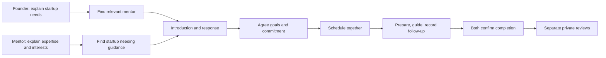

# Phase 0 — workflow and visual review

Completed October 29, 2026. Scope: current local working tree and the feedback in [the roadmap](../../UX-IMPROVEMENT-ROADMAP.md).

## Review method and evidence

Reviewed both Founder and Mentor previews in a real Chromium browser, including desktop (1440 × 1000) and mobile (390 × 844) baselines for Matches, Profile, Updates, Calendar, Settings, Introductions, and Rooms. Captured the login and founder match-details baseline. Browser artifacts live in [`output/playwright/phase0`](../../output/playwright/phase0/).

The full reciprocal walkthrough used two disposable local password accounts, because preview accounts are deliberately excluded from one another's directories. Accounts and completed profiles were initialized through the normal API; the introduction, acceptance, terms, scheduling, evidence, milestone confirmations, completion, and private reviews were exercised through the interface. The two accounts each submitted their own confirmations and reviews. The review database is `.data/ux-phase01-review.sqlite`; existing workspace data was not reset.

Baseline captures preceded the shared UI implementation. The incoming-introduction and room/session/review captures were taken during Phase 1, so they show the updated shared shell while preserving the original content layouts. The capture scripts and screenshots are local ignored artifacts; this report and the visual reference are tracked documentation.

Representative evidence:

- [Original login](../../output/playwright/phase0/before-login.png)
- [Founder Matches](../../output/playwright/phase0/founder-matches-desktop.png) and [mobile Matches](../../output/playwright/phase0/founder-matches-mobile.png)
- [Mentor Home](../../output/playwright/phase0/mentor-home-desktop.png) and [mentor empty suggestions](../../output/playwright/phase0/mentor-matches-desktop.png)
- [Mentor Profile](../../output/playwright/phase0/mentor-profile-desktop.png)
- [Calendar baseline](../../output/playwright/phase0/founder-calendar-desktop.png)
- [Incoming introduction](../../output/playwright/phase0/mentor-incoming-desktop.png)
- [Shared terms](../../output/playwright/phase0/mentor-room-terms.png), [session schedule](../../output/playwright/phase0/mentor-schedule-desktop.png), and [mobile schedule](../../output/playwright/phase0/mentor-schedule-mobile.png)
- [Milestones](../../output/playwright/phase0/mentor-milestones.png) and [released reviews](../../output/playwright/phase0/mentor-review-complete.png)

## Current journeys

| Step      | Founder                                                                | Mentor                                                                                        | Finding                                                                                                                                                                                                                   |
| --------- | ---------------------------------------------------------------------- | --------------------------------------------------------------------------------------------- | ------------------------------------------------------------------------------------------------------------------------------------------------------------------------------------------------------------------------- |
| Enter     | Select Founder preview or use a local account.                         | Select Mentor preview or use a local account.                                                 | Role previews create separate accounts, but previews cannot reciprocate introductions with each other.                                                                                                                    |
| Set up    | Explain startup, offers, needs, industry, stage and team size.         | Explain offers, needs, expertise, availability and startup interests; experience is optional. | Underlying fields differ by role, but layout and generic exchange language conceal that distinction.                                                                                                                      |
| Discover  | Browse startups and mentors, inspect fit, save a profile.              | Browse startups and inspect expertise/need fit.                                               | Founder preview has six suggestions; the default mentor preview has none, with directory scores around 10% for the three sample startups. This demonstrates a fixture mismatch, not proof that matching itself is broken. |
| Introduce | Select the collaboration type and express interest.                    | Initiate mentorship or accept/decline a founder request.                                      | Request list communicates mentorship type, but lacks a concise mentoring brief describing the immediate question or goal.                                                                                                 |
| Agree     | Define goals, scope, timeline, commitment and exchange.                | Review the same shared terms and confirm.                                                     | Mutual confirmation works. “Exchange,” “deal room,” and “lock terms” sound heavier than the mentoring task.                                                                                                               |
| Schedule  | Choose date/time or review the shared series.                          | Same scheduling control; selected time and recurrence are shared.                             | Suggested starting times are not verified availability. Both roles can change the schedule; changing it clears session confirmations.                                                                                     |
| Work      | Prepare questions, add evidence, log follow-up and confirm milestones. | Deliver guidance, add evidence and confirm milestones.                                        | Shared milestone system works, but preparation, guidance and follow-up are not prioritized by role.                                                                                                                       |
| Finish    | Confirm all milestones, mark launched and review privately.            | Confirm milestones and submit a separate private review.                                      | Completion and blind review work. “Launched” is inappropriate mentorship wording. “Engagement reviewed” as a pre-completion milestone can be confused with the private review afterward.                                  |

## Hierarchy and usability findings

| Surface             | Observed problem                                                                                                    | Selected direction                                                                                                   | Phase |
| ------------------- | ------------------------------------------------------------------------------------------------------------------- | -------------------------------------------------------------------------------------------------------------------- | ----- |
| Login               | Plain white page with little identity; brand and form feel detached from the wider workspace.                       | Quiet connection artwork behind a clearly bounded form.                                                              | 1     |
| Shared controls     | Native chevrons, corner styles, padding and text sizes vary. Long sort values can be clipped.                       | One select treatment with consistent height, chevron, focus, disabled and invalid states; preserve native semantics. | 1     |
| Navigation          | Sidebar Profile repeats the visible account-button destination. Settings symbol resembles a sun.                    | Account button owns profile entry; use a cog for Settings.                                                           | 1     |
| Feedback            | Left-colored toast stripe; outage banner and toast announce the same failure.                                       | Neutral uniform toast border; one persistent outage banner; inline failure guidance for unconfirmed saves.           | 1     |
| Matches             | Unconditional guidance banner consumes space; tabs, sorting and filtering have weak distinctions.                   | Contextual setup guidance; explicit sort label; well-separated controls.                                             | 2     |
| Match cards         | All identities use letters; mentor-facing cards emphasize what a startup offers.                                    | Mix images and fallbacks; mentor cards prioritize startup needs, stage and requested help.                           | 2/5   |
| Match details       | Long text, technical scoring information and primary action compete; overall identity is understated.               | Identity/summary first; grouped expertise and needs; clear action panel; expandable score detail.                    | 3     |
| Profile             | Viewing and editing have little visual separation; long fields and history lack hierarchy.                          | Identity header plus role-specific sections, grouped editing fields and clear save/cancel actions.                   | 3     |
| Updates             | Rows read as similar paragraphs with raw kind/read metadata; generated timestamps are refreshed during preparation. | Event rows with icons, context, stable timing and read state before adding date grouping.                            | 3     |
| Calendar            | Large decorative hero pushes the working calendar down; broad grid uses space without event detail.                 | Compact toolbar, aligned grid, useful event information and day agenda.                                              | 4     |
| Session picker      | Three columns compete at medium widths; suggestions resemble availability; confirmation summary is weak.            | Compact date picker and time list, explicit timezone and selected-slot summary.                                      | 4     |
| Mentor Home         | Generic room/introduction/saved metrics do not foreground upcoming sessions or mentee follow-up.                    | Prioritize requests needing response, next sessions and follow-up.                                                   | 5     |
| Mentor empty states | Calendar tells the mentor to “connect with a mentor.”                                                               | Role-aware copy directs mentors toward startups.                                                                     | 4/5   |

## Selected visual direction

See the [visual reference sheet](visual-reference.html). The actual Phase 1 login is captured [on desktop](../../output/playwright/phase1/login-desktop.png) and [on mobile](../../output/playwright/phase1/login-mobile.png).

- Retain the recognizable two-ribbon logo, refine its clear space and palette, and align the favicon with the same mark. Use darker green on light surfaces and lighter mint/lime on the sidebar.
- Keep the wordmark quiet and legible, using the existing system type family.
- Use warm green-gray canvas, white reading surfaces, dark ink and restrained green actions. Reserve shadows for the login card, toasts and overlays.
- Use 44px minimum select controls, 8px control radius, a single chevron, and clear keyboard focus. Native option lists retain platform behavior.
- Establish hierarchy with headings, spacing, dividers and grouped actions. Later detail/profile/update work should follow the reference rather than adding shadows to every section.
- Overview calendar and session picker share date logic but use different layouts. Their larger rework stays in Phase 4.

## Mentor decisions for implementation

The chosen mentor journey is: explain expertise → find a startup needing that expertise → review a clear request → agree a focused goal → schedule together → guide and record follow-up → mutually complete → review separately.

### Corrections using existing capabilities

1. Make mentor Home prioritize introductions, upcoming sessions, active mentees and follow-up.
2. Make mentor discovery and details foreground founder needs and startup context.
3. Rework mentor profile grouping around expertise, experience, startup interests and availability.
4. Replace inappropriate role copy, including the calendar's mentor-seeking prompt.
5. Use mentorship-specific room/completion wording while preserving shared confirmations, evidence and blind-review rules.
6. Clarify the distinction between reflecting on engagement progress and the final private review.
7. Add demo fixtures that produce relevant mentor suggestions as well as weak/no-fit cases through the real matcher.
8. Resolve the demo presentation limitation explicitly: either provide controlled reciprocal demo participants or document previews as browsing-only samples. Do not silently expose arbitrary preview accounts.

### Optional capabilities requiring a separate product decision

Structured capacity, verified availability, conflict checking, proposed/confirmed session states, cancellation/rescheduling policies, recurring-series exceptions, and private mentor notes. These introduce state or permissions beyond the current UI corrections and are not prerequisites for Phase 1.

## Coverage of all original feedback

| IDs      | Chosen target                                                               | Disposition                                              |
| -------- | --------------------------------------------------------------------------- | -------------------------------------------------------- |
| F01, F02 | Consistent logo family and quiet branded login background                   | Implemented in Phase 1                                   |
| F03      | Image-capable shared avatar with robust letter fallback                     | Phase 2                                                  |
| F04      | Remove unconditional profile guidance; use contextual help                  | Phase 2                                                  |
| F05      | Clarify sort versus tabs/filters; retain readable selected values           | Shared styling in Phase 1; discovery labeling in Phase 2 |
| F06      | Group identity, relevant help, fit details and primary action               | Phase 3                                                  |
| F07      | Shared select states and keyboard behavior                                  | Implemented in Phase 1                                   |
| F08      | Neutral toast with status icon and uniform border                           | Implemented in Phase 1                                   |
| F09      | Icon and score-help text share one hover/focus treatment                    | Phase 2                                                  |
| F10      | Expanded real-score fixtures, including sparse/no suggestions               | Phase 2                                                  |
| F11      | Exact filter button label “Show matches”                                    | Phase 2                                                  |
| F12      | Compact useful overview and focused session picker                          | Phase 4                                                  |
| F13      | Profile through account button, including mobile                            | Implemented in Phase 1                                   |
| F14, F15 | Role-aware Profile grouping and distinct Updates rows                       | Phase 3                                                  |
| F16, F17 | Settings cog and one global outage notice                                   | Implemented in Phase 1                                   |
| F18      | Mentor-specific workflow mapped and gaps separated from optional extensions | Review complete; implementation informs Phases 2–5       |

Phase 0 exit criteria are met: both role journeys were reviewed, visual baselines captured, a reference direction selected, all 18 notes mapped to target behavior, and mentor corrections distinguished from new capabilities.
